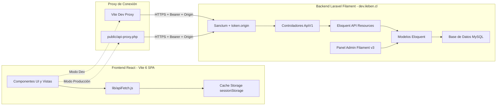
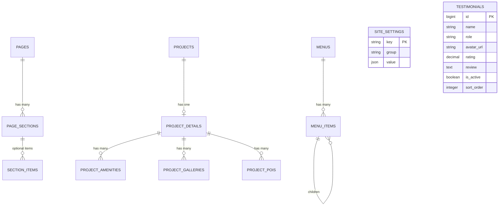

# PROJECT-BACKEND-INTEGRATION.md

> **Documento de Arquitectura e Integración Backend Laravel + Filament para Frontend React**  
> **Proyecto:** Inmobiliaria Leben (`new-leben-react` / `Leben-site`)  
> **Versión del Documento:** 1.1.1  
> **Fecha:** 2026-10-26  
> **Estado:** Fase Frontend Completada (`new-leben-react` v0.9.179) — Backend Laravel/Filament en Especificación  
> **Destinatario:** Ingeniero / IA de Backend (Laravel 11+ / Filament v3 / REST API)

---

## 1. Resumen ejecutivo

### 1.1. Contexto del Proyecto

Inmobiliaria Leben es una compañía inmobiliaria chilena de alta gama con proyectos en Santiago y en el sur de Chile (específicamente en Puerto Varas, Valdivia y Puerto Montt solamente). El ecosistema digital está compuesto por dos proyectos estrechamente acoplados:

1. **Frontend Público (`new-leben-react` / `test.ileben.cl`):** Una aplicación Single Page Application (SPA) desarrollada en React 19 y empaquetada con Vite 6, estilizada con SCSS y Bootstrap 5.3, animada mediante GSAP (ScrollTrigger) y Motion, y gestionada en su estado global con Redux Toolkit.
2. **Backend Administrativo y API (`dev.ileben.cl` / `admin.ileben.cl` - `Leben-site`):** Una plataforma monolítica en Laravel (PHP 8.2+) con panel administrativo impulsado por Filament PHP v3, que expone una API REST versionada en `/api/v1` protegida mediante Laravel Sanctum y validación de origen (`token.origin`).

### 1.2. Problema que Resuelve esta Integración

Actualmente, el frontend React ya se comunica exitosamente con el backend Laravel para consultar el catálogo general de proyectos (`/api/v1/proyectos`), asesores comerciales por proyecto (`/api/v1/proyectos/{id}?include_asesores=1`) y el listado de unidades departamentales y tipologías para el cotizador interactivo (`/api/v1/plantas`).

Sin embargo, **un gran volumen de información crítica se encuentra hardcodeado en archivos JavaScript del frontend (`src/data/*.js`) y en constantes dentro de componentes JSX**:

- Textos de landing principal, títulos, subtítulos y llamados a la acción (CTA).
- Testimonios de clientes, sellos de certificación (Best Place to Live, CChC, Calificación Energética) y métricas comerciales.
- El detalle editorial de proyectos individuales: históricamente, sólo "Edificio INN" contaba con contenido completo hardcodeado en `src/data/projects.js` y `src/pages/Inn.jsx`, lo que impedía que cualquier otro proyecto del catálogo contase con ficha rica y personalizable.
- Páginas institucionales estáticas (Nosotros, Quiénes Somos, Información de la Empresa, Proceso de Reserva en Línea, Bases Legales, Trabaja en Leben).
- Secciones comerciales completas como **Brokers** y **Leben Invest** (planes de inversión sin pie, preguntas frecuentes, categorías de comisiones).
- Opciones de formularios que simulan envíos en local mediante `setTimeout` en lugar de persistirse en la base de datos de leads de Laravel.
- Banners emergentes (`AnnouncementModal`) para horarios festivos o comunicados de contingencia.
- Menús de cabecera y enlaces legales del pie de página.
- El orden visual de los proyectos (`PROJECT_DISPLAY_ORDER`), forzado manualmente en frontend por carecer de ordenamiento administrable desde el backend.

### 1.3. Resultado Esperado

Transformar el backend Laravel + Filament en la **única fuente de verdad (Single Source of Truth - SSOT)** de la plataforma:

- Los administradores y equipos de marketing podrán editar textos, banners, imágenes, testimonios, FAQs, páginas institucionales, menús y fichas de proyectos desde Filament sin requerir despliegues ni cambios en el código de React.
- El frontend React consumirá endpoints REST estructurados, con tipado predecible, URLs absolutas para medios y soporte de caché HTTP / sessionStorage, eliminando archivos estáticos de datos (`src/data/*.js`).
- El backend procesará de forma nativa los formularios de prospección (`Brokers` e `Invest`) vinculándolos al canal correspondiente de leads (`contact_submissions`).

### 1.4. Decisión Arquitectónica Clave: Adopción de `Inn.jsx` como Estándar Canónico (COMPLETADO EN FRONTEND v0.9.179)

Se estableció de manera taxativa que la arquitectura visual y funcional desarrollada en `src/pages/Inn.jsx` constituye el **estándar oficial (plantilla canónica)** para la presentación de TODOS los proyectos de Inmobiliaria Leben.

**Hito ejecutado en Frontend (`new-leben-react` v0.9.179):**

- **Reemplazo y Purga Definitiva:** Se eliminó la estructura antigua de `ProyectoDetalle.jsx`, el archivo duplicado `src/pages/Inn.jsx` y 10 componentes obsoletos (`ProjectHero.jsx`, `ProjectTabs.jsx`, `ProjectOverview.jsx`, `FloorPlans.jsx`, `Vista360.jsx`, `SpacesGallery.jsx`, `LocationSection.jsx`, `BottomGallery.jsx`, `TeamAgents.jsx`, `AgentCard.jsx`).
- **Plantilla Canónica Unificada:** `src/pages/ProyectoDetalle.jsx` ahora centraliza la maqueta completa de alta gama: Hero de alta gama con video/logo y barra técnica `INFO`, tabs sticky con scroll spy, slider principal de fotos, bloque de marcas asociadas, slider de terminaciones principales, amenidades con íconos animados `pqoqubbw`, cotizador interactivo integrado, recorridos 360 multicanal (YouTube, Matterport, La Nube 360), sección de interiorismo, mapa con pines porcentuales interactivos (X/Y), modales de panoramas y espacios, y equipo de asesores comerciales.
- **Componentes Genéricos Reutilizables:** Se modularizaron `src/components/proyecto/ProjectTeamAgents.jsx` y `src/components/proyecto/ProjectPanoramasModal.jsx`.
- **Theming por Proyecto (CSS Custom Properties):** Cada proyecto soporta su propia paleta de acento mediante variables CSS inyectadas dinámicamente (`--lb-project-accent`, `--lb-project-accent-dark`, `--lb-project-accent-light`, `--lb-project-accent-bg`, `--lb-project-gradient`, `--lb-project-btn-shadow`). Ejemplo: Edificio INN utiliza su característico dorado (`#d9bc70`), mientras que futuros proyectos adoptarán sus colores corporativos desde el backend sin necesidad de duplicar código SCSS.
- **Política de No Programación Doble:** Para proyectos cuyo contenido aún no existe en el backend (`slug !== 'inn'`), el frontend no inventa datos mockeados; despliega un aviso informativo limpio de integración en curso y un botón para contactar o regresar al catálogo, garantizando una transición ordenada hacia la API.
- **Unificación de Rutas:** La ruta `/inn-test` redirige permanentemente a `/proyectos/inn`.

---

## 2. Arquitectura actual

### 2.1. Stack Tecnológico Detectado

#### Frontend (`new-leben-react`)

- **Runtime & Build:** Node.js, Vite 6.0.0, `@vitejs/plugin-react` 4.3.4.
- **Librería UI:** React 19.0.0, `react-dom` 19.0.0.
- **Enrutamiento:** `react-router-dom` 7.18.2 (rutas SPA, hash scrolling sincronizado).
- **Gestión de Estado:** `@reduxjs/toolkit` 2.5.0, `react-redux` 9.2.0 (`uiSlice`, `cookieSlice`, `authSlice`).
- **Diseño & Maquetación:** SCSS modular (`src/styles/`), Bootstrap 5.3.3 (`variables.scss` tokens corporativos).
- **Animaciones & Render:** GSAP 3.12.7 (ScrollTrigger, Contexts), Motion 12.43.0 (iconografía SVG interactiva `pqoqubbw`).
- **Visor Multimedia:** Fancybox 5.0.36 (`@fancyapps/ui`).
- **Seguridad & Captcha:** Cloudflare Turnstile con fallback resiliente.
- **Cumplimiento Legal:** Ley N° 21.719 de Chile sobre Protección de Datos Personales (Google Consent Mode v2 sin cookies por defecto, bloqueo de Meta Pixel).

#### Backend (`dev.ileben.cl` / `admin.ileben.cl` - Repositorio `Leben-site`)

- **Framework Core:** Laravel 11.x (PHP 8.2+).
- **Panel Administrativo:** Filament PHP v3 (gestión de recursos mediante Livewire 3).
- **Seguridad & API:** Laravel Sanctum (Personal Access Tokens) + Middleware personalizado `token.origin`.
- **Capa de Almacenamiento:** MySQL / MariaDB (motor relacional InnoDB).
- **Almacenamiento de Medios:** Local / S3 / CDN de medios WordPress heredado (`https://ileben.cl/wp-content/uploads/...`).
- **Integraciones Existentes:** Pasarelas de pago (Transbank Webpay Plus, Mercado Pago, transferencias manuales), Salesforce CRM (campos `salesforce_proyecto_id`, `salesforce_portada_url`).

### 2.2. Estructura de Carpetas Relevante

```text
c:\laragon\app\new-leben-react/
├── public/
│   ├── api-proxy.php              # Proxy cURL de producción para Apache/cPanel
│   ├── .htaccess                  # Reglas mod_rewrite para SPA y /api/* -> api-proxy.php
│   └── images/                    # Activos estáticos, marcas, renders y planos
├── src/
│   ├── App.jsx                    # Definición de rutas principales (/proyectos/:slug unificada, modales globales)
│   ├── components/
│   │   ├── layout/                # Navbar.jsx, Footer.jsx (menús hardcodeados)
│   │   ├── sections/              # Secciones de Home (Hero, Diferenciadores, Videos, etc.)
│   │   ├── proyecto/              # Componentes canónicos: Cotizador.jsx, ProjectTeamAgents.jsx, ProjectPanoramasModal.jsx, RelatedProjects.jsx, Alternatives.jsx (10 obsoletos purgados)
│   │   ├── announcement/          # Modal emergente de anuncios
│   │   └── cookies/               # Modales y banner de cookies Ley 21.719
│   ├── data/                      # ⚠️ REPOSITORIO DE DATOS HARDCODEADOS
│   │   ├── content.js             # Textos y assets de Home y footer
│   │   ├── projects.js            # Detalle hardcodeado temporal de proyecto INN (a migrar)
│   │   ├── staticPages.js         # Contenido de páginas institucionales
│   │   ├── brokers.js             # Textos y tablas de la sección Brokers
│   │   ├── invest.js              # Datos, preguntas frecuentes y planes de Invest
│   │   ├── announcementData.js    # Configuración de pop-up temporal
│   │   └── cookiesPageData.js     # Textos legales de política de privacidad
│   ├── lib/
│   │   ├── apiFetch.js            # Cliente HTTP centralizado con caché sessionStorage
│   │   └── projectUtils.js        # Mapeadores, etiquetas y orden hardcodeado de proyectos
│   └── pages/                     # Vistas lazy (ProyectoDetalle.jsx [plantilla canónica única], Invest.jsx, Brokers.jsx, etc.)
```

Estructura esperada en el backend Laravel (`scooller/Leben-site`):

```text
Leben-site/
├── app/
│   ├── Filament/Resources/        # Recursos del panel Filament
│   ├── Http/
│   │   ├── Controllers/Api/V1/    # Controladores de la API REST
│   │   ├── Middleware/            # TokenOriginMiddleware, etc.
│   │   ├── Requests/              # Validaciones FormRequest
│   │   └── Resources/             # Transformadores JsonResource de Laravel
│   └── Models/                    # Modelos Eloquent (Project, Plant, SiteSetting, etc.)
├── database/
│   ├── migrations/                # Esquema de tablas
│   └── seeders/                   # Población inicial de contenido
└── routes/
    └── api.php                    # Definición del grupo v1 de la API
```

### 2.3. Flujo de Comunicación y Seguridad

1. **Entorno de Desarrollo (Vite):**  
   Vite actúa como proxy inverso en `http://localhost:5174/api/*`. Intercepta las solicitudes y las redirige hacia `DEV_API_TARGET` (`https://dev.ileben.cl`), inyectando en cabecera:
   - `Authorization: Bearer <DEV_API_TOKEN>`
   - `Origin: https://test.ileben.cl`
   - `Referer: https://test.ileben.cl/`

2. **Entorno de Producción (Apache cPanel):**  
   El archivo `.htaccess` redirige solicitudes a `public/api-proxy.php`. Dicho script ejecuta una petición cURL hacia `https://dev.ileben.cl` adjuntando el token Sanctum preconfigurado y las cabeceras `Origin`/`Referer` autorizadas.

3. **Mecanismo de Seguridad Backend (`token.origin`):**  
   El backend Laravel verifica que el token Sanctum posea un campo o metadato `authorized_url`. Si el encabezado `Origin` o `Referer` de la solicitud entrante no coincide con `authorized_url`, la API deniega el acceso con `HTTP 403 Forbidden`.

4. **Formato de Respuesta Estándar:**
   - Listados paginados: `{ "data": [...], "meta": { "total": 120, "last_page": 6 }, "links": { ... } }`
   - Objetos únicos: `{ "data": { "id": 1, ... } }`
   - Errores de validación: `{ "message": "...", "errors": { "field": ["..."] } }`



---

## 3. Inventario de contenido hardcodeado

A continuación se detalla todo el contenido estático identificado en el frontend React que debe migrarse hacia Laravel y administrarse desde Filament:

| Área / Página | Ubicación exacta en React | Tipo de contenido | Ejemplo detectado | Debe administrarse desde | Endpoint sugerido | Prioridad |
| --- | --- | --- | --- | --- | --- | --- |
| **Home: Hero** | `src/data/content.js:43-45`, `Hero.jsx:17` | Título principal y video de fondo | *"Creando espacios donde lo cotidiano se vuelve extraordinario"*, video `Banner-Hero-Desktop.mp4` | Filament: Ajustes de Landing / Página Home | `GET /api/v1/pages/home` | Alta |
| **Home: Diferenciadores** | `src/data/content.js:47-58`, `Diferenciadores.jsx` | Títulos, badges, textos con negritas e íconos | *"Certificados 6 años consecutivos..."*, *"Top-4 Chile y Top-9 Latinoamérica 2025..."* | Filament: Bloques de Diferenciadores / Ventajas | `GET /api/v1/pages/home` | Alta |
| **Home: Testimonios** | `src/data/content.js:91-126`, `Testimonials.jsx` | Métricas de certificación, rating y reseñas de clientes | *"Rating Best Place to Live 4.5"*, testimonios de Herman Oettinger, Fernando Cid, John Von Achon con avatares | Filament: Recurso `Testimonials` | `GET /api/v1/testimonials` o integrado en `pages/home` | Media |
| **Home: Proyecto del Mes** | `src/data/content.js:128-136`, `ProjectOfMonthSection.jsx` | Noticia destacada, foto, video en marco iPhone y link | *"María Gracia en Leben"*, visita de María Gracia Subercaseaux y Waldemar Méndez a Edificio INN | Filament: Bloque de Proyecto Destacado del Mes | `GET /api/v1/pages/home` | Media |
| **Home: Videos y Obras** | `src/data/content.js:138-153`, `VideosSection.jsx` | Textos, contador de obras y fotos destacadas | *"06 Obras seleccionadas"*, imágenes principales y laterales de Edificio INN | Filament: Sección de Videos / Obras | `GET /api/v1/pages/home` | Baja |
| **Home: Banner CTA** | `src/data/content.js:24`, `CTASection.jsx` | Imagen de banner inferior | `home/Mesa de trabajo.jpg` | Filament: Banner CTA en página Home | `GET /api/v1/pages/home` | Baja |
| **Proyectos: Landing Catálogo** | `src/data/content.js:177-200` | Encabezados de catálogo, sellos de respaldo y formulario CTA | Eyebrow *"EXCLUSIVIDAD & DISEÑO"*, *"6 años certificados"*, *"4tos en Chile por calidad"* | Filament: Configuración de Catálogo / Página Proyectos | `GET /api/v1/pages/proyectos` | Media |
| **Orden de Proyectos** | `src/lib/projectUtils.js:62-76` | Ordenamiento preferencial de proyectos | Lista `PROJECT_DISPLAY_ORDER` (`baum`, `mood`, `livingtown`, `argomedo`, `santo`, `indi`...) | Filament: Campo `sort_order` / `display_order` en `ProjectResource` | `GET /api/v1/proyectos` (ordenado por `sort_order`) | Alta |
| **Ficha de Proyectos: Estándar Canónico Unificado** | `src/pages/ProyectoDetalle.jsx`, `src/data/projects.js` | Slides de proyecto, marcas asociadas con logos, amenidades con íconos animados, mapa interactivo (pines X/Y), galerías por ambiente, recorridos 360, interioristas, cotizador integrado y paleta CSS por proyecto | Formato completo de **Edificio INN** estandarizado en `ProyectoDetalle.jsx` (v0.9.179); soporta variables CSS dinámicas de color por proyecto. Backend debe proveer contenido para el resto de proyectos | Filament: Módulo integral de Proyecto (`ProjectDetail`, `ProjectAmenity`, `ProjectGallery`, `ProjectPoi`, `ProjectBrand`, `ProjectDesigner`, campo `theme_colors`) | `GET /api/v1/proyectos/{slug_or_id}/content` | **Crítica (Frontend listo, Backend pendiente)** |
| **Institucional: Nosotros** | `src/data/staticPages.js:2-144`, `StaticPage.jsx` | Historia, párrafos corporativos y lista histórica de 18 proyectos entregados con logos y fotos | Edificios MOOD, OWN, SUECIA, INDI, OKINAWA, ARGOMEDO, INDIGO, etc. | Filament: Recurso `Pages` (slug `nosotros`) + Proyectos Históricos | `GET /api/v1/pages/nosotros` | Media |
| **Institucional: Empresa** | `src/data/staticPages.js:145-162`, `StaticPage.jsx` | Razón social, RUT, representante legal, dirección y encargado de privacidad | Inmobiliaria Cenit Limitada, RUT 76.065.957-6, Rep. Legal Juan Ignacio Pinto | Filament: `SiteSettings` (categoría Legal/Empresa) | `GET /api/v1/pages/informacion-de-la-empresa` o `/site-config` | Media |
| **Institucional: Proceso de Reserva** | `src/data/staticPages.js:163-184`, `StaticPage.jsx` | Etapas del proceso de reserva online y cláusula de retracto | Pasos 1 a 8, explicación de plazos de 10 días hábiles y derecho a retracto | Filament: Recurso `Pages` (slug `proceso-reserva-en-linea`) | `GET /api/v1/pages/proceso-reserva-en-linea` | Media |
| **Institucional: Bases Legales** | `src/data/staticPages.js:185-201`, `StaticPage.jsx` | Textos de protocolización notarial y enlace a PDF | Bases en Notaría San Martín Schröder, enlace a `20251203-Bases-Promocion.pdf` | Filament: Recurso `Pages` (slug `bases-legales`) | `GET /api/v1/pages/bases-legales` | Media |
| **Institucional: Trabaja en Leben** | `src/data/staticPages.js:202-213`, `StaticPage.jsx` | Párrafos de convocatoria laboral y correo de postulación | Convocatoria y correo `seleccion@ileben.cl` | Filament: Recurso `Pages` (slug `trabaja-en-leben`) | `GET /api/v1/pages/trabaja-en-leben` | Media |
| **Sección Brokers** | `src/data/brokers.js:8-100`, `Brokers.jsx` | Hero, beneficios del círculo Leben, tabla comparativa de tiers (Black, Gold, Silver) y eventos | Tiers de ventas (15.000 UF, 10.000 UF), comisiones, plazos de pago y galería de eventos | Filament: Recurso `Pages` (slug `brokers`) o módulo `BrokerProgram` | `GET /api/v1/pages/brokers` | Alta |
| **Formulario Brokers** | `src/pages/Brokers.jsx:95-120` | Captura de postulaciones de corredores | Formulario que ejecuta simulación local con `setTimeout` | Backend: Integrar a `contact_submissions` canal `broker` | `POST /api/v1/contact-submissions` | Alta |
| **Sección Invest** | `src/data/invest.js:8-285`, `Invest.jsx` | Hero "Sin Pie", beneficios de inversión, asesoría, proceso de 4 pasos, smart banner y 10 preguntas FAQ | 10 preguntas de Cap Rate, 55bis, IVA, DFL-2, arriendo garantizado 36 meses | Filament: Recurso `Pages` (slug `invest`) + `FaqResource` | `GET /api/v1/pages/invest` | Alta |
| **Formulario Invest** | `src/pages/Invest.jsx:79-105` | Captura de inversionistas potenciales | Opciones de renta hardcodeadas; simulación local sin persistencia | Backend: Integrar a `contact_submissions` canal `investor` | `POST /api/v1/contact-submissions` | Alta |
| **Avisos de Contingencia** | `src/data/announcementData.js:5-21`, `AnnouncementModal.jsx` | Pop-up de avisos especiales (feriados, horarios de atención) | `enabled: false`, `id: 'aviso-atencion-especial-2026'`, título, mensaje y texto del botón | Filament: Configuración de Anuncios / Pop-up en `SiteSettings` | `GET /api/v1/site-config` o `/announcement` | Media |
| **Política de Cookies** | `src/data/cookiesPageData.js`, `CookiesPage.jsx` | Textos legales de Ley 21.719, categorías de cookies y derechos ARCOP-B | Texto íntegro de la declaración de cookies y finalidades técnicas | Filament: Recurso `Pages` (slug `cookies`) | `GET /api/v1/pages/cookies` | Baja |
| **Menús de Navegación** | `Navbar.jsx:81-120`, `Footer.jsx:54-63` | Enlaces principales, enlaces de dropdown agrupados, enlaces corporativos y copyright | Enlaces a Buk, Denuncias, Locales Comerciales, Quienes Somos | Filament: Recurso `Menus` / `NavigationMenu` | `GET /api/v1/menus/{location}` | Media |
| **Footer Corporativo** | `src/data/content.js:155-171`, `Footer.jsx` | Párrafo legal protocolizado, dirección física, horarios, teléfonos, email y redes sociales | Notaría San Martín N° 17917-2025; Dr. Manuel Barros Borgoño 386; `info@ileben.cl` | Filament: `SiteSettings` (categoría Footer / Contacto) | `GET /api/v1/site-config` | Alta |
| **Portal de Usuario: Clientes / Compradores (Futuro)** | `src/data/users.js:6-60`, `PerfilComprador.jsx` | Datos de comprador, unidad adquirida, avance de obra (hitos), documentos descargables, noticias y notificaciones | Objeto mock de María González (Depto 502 Edificio INN, 35% avance, documentos como Promesa y Reserva) | Filament: Módulo de Clientes / Propietarios y Unidades Adquiridas | `GET /api/v1/buyer/profile` | Baja (Fase Futura) |
| **Portal de Usuario: Brokers / Partners (Futuro)** | `src/data/users.js:61-105`, `PerfilBroker.jsx` | Métricas de broker, nivel de tier (Silver/Gold/Black), ventas y comisiones, eventos y pack de recursos de marketing | Objeto mock de Carlos Muñoz (Tier Silver, 7.200 UF vendidas, comisiones pagadas/pendientes, brochures y renders 4K) | Filament: Módulo de Gestión de Brokers y Liquidaciones | `GET /api/v1/broker/dashboard` | Baja (Fase Futura) |

---

## 4. Mapa de endpoints actuales

Estado de los endpoints de la API en `https://dev.ileben.cl/api/v1`:

| Método | Endpoint | Controlador sugerido en Laravel | Respuesta actual | Uso en React | Estado | Observaciones |
| --- | --- | --- | --- | --- | --- | --- |
| `GET` | `/api/v1` | `ApiDiscoveryController@index` | Esquema OpenAPI 3.0 en JSON | Herramientas de desarrollo / documentación | Existente | Permite descubrir tags y esquemas de seguridad. |
| `GET` | `/api/v1/site-config` | `SiteSettingController@forFrontend` | Objeto de configuración general | No consumido activamente en React actualmente | Parcial | Debe extenderse para retornar datos de pie de página, avisos pop-up y metadatos globales. |
| `GET` | `/api/v1/proyectos` | `ProjectController@index` | Array de proyectos con ID, nombre, comuna, etapa, tipologías y precio | `ProyectoDetalle.jsx`, `CotizadorGeneral.jsx`, `VideosSection.jsx`, `Inn.jsx` | Parcial | No devuelve el contenido editorial profundo (amenidades, galerías, 360, entorno) ni soporta ordenamiento visual personalizado. |
| `GET` | `/api/v1/proyectos/{id}` | `ProjectController@show` | Objeto individual de proyecto | `TeamAgents.jsx`, `InnTeamAgents.jsx` (con `?include_asesores=1`) | Parcial | Si se invoca con `include_asesores=1`, retorna el array `asesores`. No entrega la estructura completa de páginas de detalle. |
| `GET` | `/api/v1/plantas` | `PlantController@index` | Listado paginado de unidades filtrables por proyecto, precio, piso, etc. | `Cotizador.jsx`, `RelatedProjects.jsx` | Existente | Totalmente operativo para cotizaciones en tiempo real. |
| `GET` | `/api/v1/plantas/{id}` | `PlantController@show` | Detalle específico de planta/unidad | Navegación directa en cotizador | Existente | Correcto. |
| `GET` | `/api/v1/plantas/filtros-ubicacion` | `PlantController@filtrosUbicacion` | Regiones y comunas con unidades | Asistente de búsqueda en cotizador | Existente | Operativo. |
| `GET` | `/api/v1/plantas/proyecto/{slug}/unidad/{name}` | `PlantController@byUnitName` | Detalle de unidad por nombre | Enlaces directos a departamentos | Existente | Operativo. |
| `POST` | `/api/v1/contact-submissions` | `ContactSubmissionController@store` | Confirmación de lead registrado | Actualmente preparado para formulario general de contacto | Insuficiente | No está conectado con los formularios de `Brokers.jsx`, `Invest.jsx` ni `TrabajaForm.jsx`. |
| `POST` | `/api/v1/login` | `AuthController@login` | `{ "user": {...}, "token": "..." }` | `Login.jsx` | Existente | Autenticación de compradores/brokers. |
| `GET` | `/api/v1/me` | `AuthController@me` | Objeto del usuario autenticado | Perfiles (`PerfilBroker`, `PerfilComprador`) | Existente | Requiere `auth:sanctum`. |
| `POST` | `/api/v1/logout` | `AuthController@logout` | Confirmación de cierre de sesión | Perfiles de usuario | Existente | Requiere `auth:sanctum`. |
| `GET` | `/api/v1/pages/{slug}` | *Inexistente* | 404 Not Found | Ninguno (actualmente lee `staticPages.js`) | **Faltante** | Indispensable para páginas institucionales y landings. |
| `GET` | `/api/v1/proyectos/{slug}/content` | *Inexistente* | 404 Not Found | Ninguno (actualmente lee `projects.js`) | **Faltante** | Indispensable para que cualquier proyecto tenga ficha rica administrable. |
| `GET` | `/api/v1/menus/{location}` | *Inexistente* | 404 Not Found | Ninguno (actualmente lee `Navbar.jsx`) | **Faltante** | Requerido para menús dinámicos de cabecera y pie. |
| `GET` | `/api/v1/testimonials` | *Inexistente* | 404 Not Found | Ninguno (actualmente lee `content.js`) | **Faltante** | Requerido para testimonios y ratings en Home. |

---

## 5. Modelo de datos propuesto

Para satisfacer los requerimientos sin caer en sobreingeniería (siguiendo el principio YAGNI y buenas prácticas de Laravel), se propone una arquitectura híbrida:

- Tablas tipadas para entidades con relaciones fuertes y filtros estructurados (Páginas, Secciones, Contenidos de Proyecto, Testimonios y Menús).
- Almacenamiento JSON para cargas configurables específicas de cada bloque visual (`payload`), permitiendo extrema flexibilidad en Filament mediante componentes `Builder` o `Repeater`.



### 5.1. Entidad: `SiteSettings` (Ajustes Globales)

Aprovechar o extender la tabla existente utilizada por `SiteSetting::forFrontend`.

- **Tabla:** `site_settings`
- **Campos:**
  - `id` (bigint, unsigned, primary key)
  - `group` (string 50, not null, index): `general`, `contact`, `social`, `footer`, `announcement`, `legal`
  - `key` (string 100, not null, unique): ej. `contact_phone`, `announcement_banner`, `footer_legal_disclaimer`
  - `value` (json, nullable): estructura libre (texto plano, objeto o array)
  - `created_at`, `updated_at` (timestamps)
- **Identificador para React:** `key` o consulta agrupada por `group`.
- **Validaciones Filament:** Formularios tipo pestaña (Tabs) organizados por grupo en un `SettingsPage` o recurso individual.

### 5.2. Entidad: `Pages` y `PageSections` (Páginas Institucionales y Landings)

Permite gestionar la Home, INN Landing, Nosotros, Quiénes Somos, Bases Legales, Brokers e Invest desde una estructura uniforme.

#### Tabla `pages`

- **Campos:**
  - `id` (bigint, unsigned, primary key)
  - `slug` (string 100, not null, unique, index): ej. `home`, `nosotros`, `brokers`, `invest`, `bases-legales`
  - `title` (string 255, not null)
  - `subtitle` (string 255, nullable)
  - `badge` (string 100, nullable): etiqueta superior (ej. *"Círculo Leben"*, *"Legal"*)
  - `hero_image_url` (string 500, nullable)
  - `hero_video_url` (string 500, nullable)
  - `seo_title` (string 255, nullable)
  - `seo_description` (text, nullable)
  - `seo_og_image_url` (string 500, nullable)
  - `is_published` (boolean, default true, index)
  - `created_at`, `updated_at`, `deleted_at` (timestamps, softDeletes)
- **Relaciones:** `hasMany(PageSection::class)->orderBy('sort_order')`

#### Tabla `page_sections`

- **Campos:**
  - `id` (bigint, unsigned, primary key)
  - `page_id` (bigint, unsigned, foreign key -> `pages.id`, onDelete cascade, index)
  - `section_key` (string 100, not null, index): ej. `hero`, `diferenciadores`, `testimonials`, `project_of_month`, `value_prop`, `faq`, `tiers`, `company_details`
  - `title` (string 255, nullable)
  - `subtitle` (string 255, nullable)
  - `eyebrow` (string 100, nullable)
  - `type` (string 50, not null): `hero`, `cards_grid`, `features_list`, `faq_accordion`, `banner_cta`, `custom`
  - `data` (json, nullable): objeto con el contenido estructurado de la sección (links, botones, textos secundarios, configuración visual)
  - `sort_order` (integer, default 0, index)
  - `is_active` (boolean, default true, index)
  - `created_at`, `updated_at` (timestamps)

### 5.3. Entidad: `ProjectDetails` (Contenido Enriquecido — Estándar Canónico `Inn.jsx`)

Se vincula 1 a 1 con el modelo existente `Project` (evitando alterar la tabla maestra de proyectos sincronizada con Salesforce) y proporciona la totalidad de la estructura requerida por la plantilla canónica `Inn.jsx` para cualquier proyecto del catálogo.

#### Tabla `project_details`

- **Campos:**
  - `id` (bigint, unsigned, primary key)
  - `project_id` (bigint, unsigned, unique, foreign key -> `projects.id`, onDelete cascade, index)
  - `hero_eyebrow` (string 150, nullable)
  - `hero_title` (string 255, nullable)
  - `hero_subtitle` (string 255, nullable)
  - `hero_video_url` (string 500, nullable): video de fondo del banner hero
  - `hero_logo_url` (string 500, nullable): isotipo/logo particular del proyecto
  - `theme_colors` (json, nullable): paleta de color para tokens CSS (`accent`, `accent_dark`, `accent_light`, `accent_bg`, `gradient`, `btn_shadow`). Inyectada dinámicamente en `--lb-project-*`
  - `technical_info` (json, nullable): array de especificaciones para barra sticky `INFO`
  - `project_slides` (json, nullable): array de diapositivas principales de proyecto
  - `equipment_brands` (json, nullable): logos de marcas aliadas/equipamiento
  - `equipment_slides` (json, nullable): diapositivas del slider de equipamiento principal
  - `overview_title` (string 255, nullable)
  - `overview_description` (text, nullable)
  - `overview_images` (json, nullable): array de URLs para el collage (left, rightTop, rightBottom)
  - `overview_stats` (json, nullable): array de objetos `[{ "value": "2-4", "label": "Dormitorios" }]`
  - `terminaciones_title` (string 255, nullable)
  - `terminaciones_description` (text, nullable)
  - `terminaciones_items` (json, nullable): array de objetos `[{ "label": "Horno Franke", "icon": "flame", "image_url": "..." }]`
  - `virtual_tour_matterport_url` (string 500, nullable): enlace o iframe Matterport 3D
  - `virtual_tour_360_url` (string 500, nullable): enlace visor 360 (ej. La Nube 360)
  - `virtual_tour_video_url` (string 500, nullable): enlace video de recorrido (YouTube o archivo)
  - `brochure_pdf_url` (string 500, nullable)
  - `designers` (json, nullable): array de interioristas y directores de arte
  - `panoramas` (json, nullable): actividades turísticas y panoramas de la zona para el modal de panoramas
  - `entorno_description` (text, nullable)
  - `entorno_map_image_url` (string 500, nullable): imagen base del mapa para pines interactivos
  - `created_at`, `updated_at` (timestamps)
- **Relaciones:**
  - `belongsTo(Project::class)`
  - `hasMany(ProjectAmenity::class)`
  - `hasMany(ProjectGallery::class)`
  - `hasMany(ProjectPoi::class)`

#### Tabla `project_amenities` (Espacios Comunes)

- **Campos:**
  - `id` (bigint, unsigned, primary key)
  - `project_detail_id` (bigint, unsigned, foreign key -> `project_details.id`, onDelete cascade, index)
  - `name` (string 150, not null)
  - `icon_key` (string 50, not null): `bell`, `table`, `chef-hat`, `dumbbell`, `waves-ladder`, `kayak`, `hot-tub`
  - `image_url` (string 500, not null)
  - `link_url` (string 500, nullable)
  - `sort_order` (integer, default 0, index)
  - `created_at`, `updated_at` (timestamps)

#### Tabla `project_pois` (Puntos de Interés del Entorno / Mapa)

- **Campos:**
  - `id` (bigint, unsigned, primary key)
  - `project_detail_id` (bigint, unsigned, foreign key -> `project_details.id`, onDelete cascade, index)
  - `name` (string 150, not null)
  - `category` (string 100, not null): `Gastronomía`, `Supermercado`, `Entretenimiento`, `Interés`
  - `distance` (string 50, not null): ej. `1.2 km`
  - `walking_time` (string 50, not null): ej. `12 minutos`
  - `image_url` (string 500, nullable)
  - `coordinate_x` (decimal 5,2, not null): posición en porcentaje X (0.00 a 100.00)
  - `coordinate_y` (decimal 5,2, not null): posición en porcentaje Y (0.00 a 100.00)
  - `pin_direction` (enum, default 'right'): `right`, `left`, `top`, `bottom`
  - `sort_order` (integer, default 0)
  - `created_at`, `updated_at` (timestamps)

#### Tabla `project_galleries` (Galerías de Espacios y Fotos Finales)

- **Campos:**
  - `id` (bigint, unsigned, primary key)
  - `project_detail_id` (bigint, unsigned, foreign key -> `project_details.id`, onDelete cascade, index)
  - `category` (string 50, not null, index): `spaces` (espacios de vida), `bottom` (galería inferior), `modal_spaces`
  - `title` (string 150, nullable)
  - `image_url` (string 500, not null)
  - `thumbnail_url` (string 500, nullable)
  - `alt_text` (string 255, nullable)
  - `sort_order` (integer, default 0)
  - `created_at`, `updated_at` (timestamps)

### 5.4. Entidad: `Testimonials` (Reseñas de Clientes)

- **Tabla:** `testimonials`
- **Campos:**
  - `id` (bigint, unsigned, primary key)
  - `name` (string 150, not null)
  - `role` (string 150, not null): ej. *"Propietario en Puerto Varas"*
  - `avatar_url` (string 500, nullable)
  - `rating` (decimal 2,1, default 5.0)
  - `review_text` (text, not null)
  - `review_date_human` (string 50, nullable): ej. *"hace 17 meses"* o fecha ISO
  - `is_published` (boolean, default true, index)
  - `sort_order` (integer, default 0, index)
  - `created_at`, `updated_at` (timestamps)

### 5.5. Entidad: `Menus` y `MenuItems` (Navegación Dinámica)

- **Tabla `menus`:**
  - `id` (bigint, unsigned, primary key)
  - `location` (string 50, unique, index): `header_main`, `header_dropdown`, `footer_corporate`, `footer_legal`
  - `name` (string 100, not null)
  - `created_at`, `updated_at` (timestamps)
- **Tabla `menu_items`:**
  - `id` (bigint, unsigned, primary key)
  - `menu_id` (bigint, unsigned, foreign key -> `menus.id`, onDelete cascade, index)
  - `parent_id` (bigint, unsigned, nullable, foreign key -> `menu_items.id`, onDelete cascade, index)
  - `label` (string 150, not null)
  - `url` (string 500, not null): ruta relativa o URL absoluta
  - `target` (string 20, default '_self'): `_self`, `_blank`
  - `is_featured` (boolean, default false): botón destacado / resaltado
  - `badge` (string 50, nullable)
  - `sort_order` (integer, default 0, index)
  - `is_active` (boolean, default true)
  - `created_at`, `updated_at` (timestamps)

---

## 6. Diseño de la API propuesta

Todos los endpoints respetan las siguientes convenciones arquitectónicas:

1. **Versionamiento:** Ruta base `/api/v1/`.
2. **Seguridad:** Middleware `token.origin` (Bearer Sanctum + cabecera `Origin` autorizada).
3. **Formato:** Transformación estricta mediante Laravel API Resources (`JsonResource`).
4. **URLs Absolutas:** Toda imagen o video devuelto utiliza `asset(Storage::url($path))` o la URL completa de CDN.
5. **Caché Pública:** Uso de cabeceras HTTP `Cache-Control: public, max-age=300, stale-while-revalidate=600` para endpoints de lectura de contenido estático.

---

### Endpoint 1: Obtener Página Dinámica con Secciones

```http
GET /api/v1/pages/{slug}
```

- **Propósito:** Retorna metadatos, contenido hero y todas las secciones configuradas para una página específica (`home`, `nosotros`, `brokers`, `invest`, etc.).
- **Controlador:** `App\Http\Controllers\Api\V1\PageController@show`
- **Resource:** `App\Http\Resources\Api\V1\PageResource`
- **Caché:** 5 minutos (Redis / Tagged Cache `pages`).

#### Respuesta Exitosa (200 OK)

```json
{
  "data": {
    "slug": "home",
    "title": "Inicio",
    "subtitle": null,
    "badge": null,
    "hero": {
      "title": "Creando espacios donde lo cotidiano se vuelve extraordinario",
      "video_url": "[https://dev.ileben.cl/storage/video/Banner-Hero-Desktop.mp4](https://dev.ileben.cl/storage/video/Banner-Hero-Desktop.mp4)",
      "image_url": null
    },
    "seo": {
      "title": "Inmobiliaria Leben | Espacios que Transforman",
      "description": "Proyectos inmobiliarios de alto estándar en Santiago y el Sur de Chile.",
      "og_image": "[https://dev.ileben.cl/storage/brand/og-image.jpg](https://dev.ileben.cl/storage/brand/og-image.jpg)"
    },
    "sections": [
      {
        "key": "diferenciadores",
        "title": "Descubre cómo hacemos la diferencia en la experiencia inmobiliaria",
        "type": "features_list",
        "sort_order": 1,
        "data": {
          "items": [
            {
              "badge_image": "[https://dev.ileben.cl/storage/brand/sello-5.svg](https://dev.ileben.cl/storage/brand/sello-5.svg)",
              "text": "Certificados <b>6 años consecutivos</b> como una de las mejores inmobiliarias para vivir."
            },
            {
              "badge_image": "[https://dev.ileben.cl/storage/brand/sello4.png](https://dev.ileben.cl/storage/brand/sello4.png)",
              "text": "<b>Top-4 Chile y Top-9 Latinoamérica</b> 2025 en satisfacción y acompañamiento al cliente."
            }
          ]
        }
      },
      {
        "key": "project_of_month",
        "title": "María Gracia en Leben",
        "type": "custom",
        "sort_order": 2,
        "data": {
          "description": "La creadora de contenido y conductora María Gracia Subercaseaux visitó...",
          "photo_url": "[https://dev.ileben.cl/storage/inn/RAPC_EXT_Elevacioen-Tarde_Media16.jpg](https://dev.ileben.cl/storage/inn/RAPC_EXT_Elevacioen-Tarde_Media16.jpg)",
          "video_url": "[https://dev.ileben.cl/storage/video/maria-gracia.mp4](https://dev.ileben.cl/storage/video/maria-gracia.mp4)",
          "cta": {
            "label": "Ver proyecto INN",
            "url": "/inn-test"
          }
        }
      }
    ]
  }
}
```

#### Respuesta de Error (404 Not Found)

```json
{
  "error": "Página no encontrada",
  "code": "PAGE_NOT_FOUND"
}
```

---

### Endpoint 2: Contenido Editorial y Ficha Completa de Proyecto (Estándar Canónico `Inn.jsx`)

```http
GET /api/v1/proyectos/{slug_or_id}/content
```

- **Propósito:** Retorna la información visual completa y estructurada bajo el estándar canónico `Inn.jsx` para cualquier proyecto del catálogo (`/proyectos/{slug}`). Reemplaza definitivamente la estructura antigua de `ProyectoDetalle.jsx`.
- **Controlador:** `App\Http\Controllers\Api\V1\ProjectDetailController@show`
- **Resource:** `App\Http\Resources\Api\V1\ProjectDetailResource`

#### Respuesta Exitosa (200 OK)

```json
{
  "data": {
    "project_id": 9,
    "slug": "inn",
    "name": "Edificio INN",
    "theme": {
      "accent": "#d9bc70",
      "accent_dark": "#c4a355",
      "accent_light": "#e2ca8d",
      "accent_bg": "rgba(217, 188, 112, 0.12)",
      "gradient": "linear-gradient(135deg, #d9bc70 0%, #b89345 100%)",
      "btn_shadow": "0 8px 24px rgba(217, 188, 112, 0.35)"
    },
    "hero": {
      "title": "El Sur se vive frente al lago",
      "subtitle": "Conexión Urbana & Paisajismo Interior",
      "location": "Puerto Varas",
      "video_url": "[https://dev.ileben.cl/storage/video/hero-inn.mp4](https://dev.ileben.cl/storage/video/hero-inn.mp4)",
      "logo_url": "[https://dev.ileben.cl/storage/inn/inn-logo.png](https://dev.ileben.cl/storage/inn/inn-logo.png)"
    },
    "technical_info": [
      { "id": "direccion", "label": "Dirección", "value": "Vicente Pérez Rosales 991,<br /> Puerto Varas" },
      { "id": "tipologias", "label": "Tipologías", "value": "Deptos de 2, 3 y 4 dorms, dúplex <br />y deptos con patio privado" },
      { "id": "metrajes", "label": "Metrajes", "value": "Desde 85 m²" },
      { "id": "precio", "label": "Precio desde", "value": "UF 9.816" },
      { "id": "estado", "label": "Estado del proyecto", "value": "Venta en Verde" }
    ],
    "project_slides": [
      { "img": "[https://dev.ileben.cl/storage/inn/proyecto/Proyecto_01_Acceso.jpg](https://dev.ileben.cl/storage/inn/proyecto/Proyecto_01_Acceso.jpg)", "alt": "Acceso" },
      { "img": "[https://dev.ileben.cl/storage/inn/proyecto/Proyecto_02_Cocina.jpg](https://dev.ileben.cl/storage/inn/proyecto/Proyecto_02_Cocina.jpg)", "alt": "Cocina" }
    ],
    "equipment": {
      "brands": [
        { "src": "[https://dev.ileben.cl/storage/logos/franke.png](https://dev.ileben.cl/storage/logos/franke.png)", "alt": "Franke" },
        { "src": "[https://dev.ileben.cl/storage/logos/mk.png](https://dev.ileben.cl/storage/logos/mk.png)", "alt": "MK" }
      ],
      "slides": [
        { "img": "[https://dev.ileben.cl/storage/inn/equipamiento/Equipamiento_Principal_Hall_Acceso.jpg](https://dev.ileben.cl/storage/inn/equipamiento/Equipamiento_Principal_Hall_Acceso.jpg)", "alt": "Hall de acceso" }
      ]
    },
    "overview": {
      "eyebrow": "1. Proyecto | Único en su clase",
      "title": "El Sur se vive frente al lago",
      "description": "Descubre el privilegio de vivir en primera línea frente al Lago Llanquihue...",
      "collage": {
        "left": "[https://dev.ileben.cl/storage/inn/inn-overview-1.jpg](https://dev.ileben.cl/storage/inn/inn-overview-1.jpg)",
        "right_top": "[https://dev.ileben.cl/storage/inn/inn-overview-2.jpg](https://dev.ileben.cl/storage/inn/inn-overview-2.jpg)",
        "right_bottom": "[https://dev.ileben.cl/storage/inn/inn-overview-3.jpg](https://dev.ileben.cl/storage/inn/inn-overview-3.jpg)"
      },
      "stats": [
        { "value": "2 -  3 -  4", "label": "Dormitorios" },
        { "value": "Desde 85 m²", "label": "Superficie útil" },
        { "value": "Franke", "label": "Equipamiento en cocina" }
      ]
    },
    "terminaciones": {
      "eyebrow": "2. Terminaciones | Diseñadas para durar",
      "title": "Terminaciones",
      "description": "Equipamiento premium marca Franke: horno, microondas...",
      "items": [
        { "label": "Horno Franke", "icon": "flame", "image_url": "[https://dev.ileben.cl/storage/inn/terminaciones/horno.jpg](https://dev.ileben.cl/storage/inn/terminaciones/horno.jpg)" }
      ]
    },
    "virtual_tours": {
      "matterport_url": "[https://my.matterport.com/show/?m=hQ8Fm33FqFY&brand=0](https://my.matterport.com/show/?m=hQ8Fm33FqFY&brand=0)",
      "panoramic_360_url": "[https://www.lanube360.com/ileben1/](https://www.lanube360.com/ileben1/)",
      "video_url": null
    },
    "designers": [
      {
        "name": "Sofía Iturralde<br/><small>Interiorista</small>",
        "image": "[https://dev.ileben.cl/storage/inn/Foto_Iturralde.jpg](https://dev.ileben.cl/storage/inn/Foto_Iturralde.jpg)",
        "alt": "Diseño de Sofía Iturralde",
        "color": "#d9bc70"
      },
      {
        "name": "Rafael Rivera<br/><small>Iluminador</small>",
        "image": "[https://dev.ileben.cl/storage/inn/Foto_Rivera.jpg](https://dev.ileben.cl/storage/inn/Foto_Rivera.jpg)",
        "alt": "Diseño de Rafael Rivera",
        "color": "#b78d56"
      }
    ],
    "panoramas": [
      {
        "category": "Naturaleza",
        "title": "Lago Llanquihue y Volcanes",
        "image": "[https://dev.ileben.cl/storage/inn/panoramas/lago.jpg](https://dev.ileben.cl/storage/inn/panoramas/lago.jpg)",
        "description": "Vistas despejadas y navegación náutica de primer nivel."
      }
    ],
    "amenities": [
      {
        "id": 1,
        "name": "Hall de acceso",
        "icon_key": "bell",
        "image_url": "[https://dev.ileben.cl/storage/inn/eecc/EECC_Hall_Acceso_Edificio.jpg](https://dev.ileben.cl/storage/inn/eecc/EECC_Hall_Acceso_Edificio.jpg)"
      },
      {
        "id": 2,
        "name": "Bodega náutica",
        "icon_key": "kayak",
        "image_url": "[https://dev.ileben.cl/storage/inn/eecc/EECC_Bodega_Nautica.jpg](https://dev.ileben.cl/storage/inn/eecc/EECC_Bodega_Nautica.jpg)"
      }
    ],
    "pois": [
      {
        "id": 1,
        "name": "Mesa Tropera",
        "category": "Gastronomía",
        "distance": "1.2 km",
        "walking_time": "12 minutos",
        "coordinate_x": 15.1,
        "coordinate_y": 33.2,
        "pin_direction": "right",
        "image_url": "[https://dev.ileben.cl/storage/inn/ubicacion/Mesa_Tropera_AI.jpg](https://dev.ileben.cl/storage/inn/ubicacion/Mesa_Tropera_AI.jpg)"
      }
    ],
    "bottom_gallery": [
      {
        "url": "[https://dev.ileben.cl/storage/inn/galeria1.jpg](https://dev.ileben.cl/storage/inn/galeria1.jpg)",
        "alt": "Vista fachada lago"
      }
    ]
  }
}
```

---

### Endpoint 3: Configuración Global del Sitio

```http
GET /api/v1/site-config
```

- **Propósito:** Entrega información institucional de pie de página, redes sociales, horarios de atención y el aviso emergente (`announcement`).

#### Respuesta Exitosa (200 OK)

```json
{
  "data": {
    "company": {
      "razon_social": "Inmobiliaria Cenit Limitada",
      "rut": "76.065.957-6",
      "representante_legal": "Juan Ignacio Pinto",
      "rut_representante": "15.378.760-3",
      "address": {
        "street": "Dr. Manuel Barros Borgoño 386",
        "city": "Providencia, Santiago, Chile"
      },
      "schedule": [
        "Lun a Vie: 09:00 a 14:00 hrs",
        "y 15:00 a 18:00 hrs"
      ],
      "phone": "+569 9129 7804",
      "email": "info@ileben.cl"
    },
    "social_links": {
      "facebook": "[https://www.facebook.com/inmobiliarialeben](https://www.facebook.com/inmobiliarialeben)",
      "instagram": "[https://www.instagram.com/inmobiliarialeben](https://www.instagram.com/inmobiliarialeben)",
      "linkedin": "[https://www.linkedin.com/company/ileben/posts/?feedView=all](https://www.linkedin.com/company/ileben/posts/?feedView=all)"
    },
    "legal": {
      "disclaimer": "La promoción se encuentra adscrita en las Bases de promoción protocolizadas...",
      "copyright": "© 2026 Leben. Todos los derechos reservados."
    },
    "announcement": {
      "enabled": false,
      "id": "aviso-atencion-especial-2026",
      "title": "Horario Especial de Atención",
      "message": "Informamos a nuestros clientes e inversionistas que...",
      "button_text": "Entendido"
    }
  }
}
```

---

### Endpoint 4: Listado de Menús de Navegación

```http
GET /api/v1/menus/{location}
```

- **Parámetros:** `location` (`header_main`, `header_dropdown`, `footer_corporate`, `footer_legal`).
- **Respuesta:**

```json
{
  "data": {
    "location": "header_main",
    "items": [
      { "id": 1, "label": "Invest", "url": "/invest", "target": "_self", "is_featured": false },
      { "id": 2, "label": "Brokers", "url": "/brokers", "target": "_self", "is_featured": false },
      { "id": 3, "label": "Cotizar", "url": "/cotizador#cotizador-gral", "target": "_self", "is_featured": true },
      { "id": 4, "label": "Clientes", "url": "/login", "target": "_self", "is_featured": false }
    ]
  }
}
```

---

### Endpoint 5: Envío de Formularios de Contacto (General, Brokers e Invest)

```http
POST /api/v1/contact-submissions
```

- **Propósito:** Recepciona leads desde la web y los clasifica según el canal (`sale`, `broker`, `investor`, `job`).
- **Cabeceras Requeridas:** `Content-Type: application/json`, `Accept: application/json`.
- **Cuerpo Requerido:**

```json
{
  "channel": "broker",
  "fields": {
    "name": "Carlos González",
    "email": "carlos@corretajes.cl",
    "phone": "+56987654321",
    "rut": "12.345.678-9",
    "region": "Metropolitana",
    "comuna": "Las Condes",
    "mensaje": "Quiero postular a la categoría Partner Black"
  },
  "turnstile_token": "0x4AAAAAA..."
}
```

#### Respuesta Exitosa (201 Created)

```json
{
  "success": true,
  "message": "Tu solicitud ha sido recibida con éxito. Un ejecutivo se contactará a la brevedad.",
  "data": {
    "submission_id": 452
  }
}
```

---

## 7. Plan de implementación en Laravel + Filament

### Fase 1 — Arquitectura de Base de Datos y Modelos Eloquent

- **Objetivo:** Crear el esquema relacional que soportará páginas dinámicas, secciones, detalles editoriales de proyecto, testimonios, menús y ajustes globales.
- **Migraciones a Generar:**
  1. `create_site_settings_table.php` (si no existe o requiere ampliación para valores JSON).
  2. `create_pages_table.php` y `create_page_sections_table.php`.
  3. `create_project_details_table.php`, `create_project_amenities_table.php`, `create_project_pois_table.php`, `create_project_galleries_table.php`.
  4. `add_sort_order_to_projects_table.php` (para persistir el orden del catálogo `sort_order` en lugar de usar `PROJECT_DISPLAY_ORDER` en React).
  5. `create_testimonials_table.php`.
  6. `create_menus_table.php` y `create_menu_items_table.php`.
- **Modelos Eloquent con casts y relaciones:**
  - `App\Models\Page`: `hasMany(PageSection::class)`, casts `json` para metadatos.
  - `App\Models\PageSection`: `belongsTo(Page::class)`, cast `data => 'array'`, scopes `active()`, `ordered()`.
  - `App\Models\ProjectDetail`: `belongsTo(Project::class)`, `hasMany(ProjectAmenity::class)`, `hasMany(ProjectPoi::class)`, `hasMany(ProjectGallery::class)`. Casts `array` para stats, collage y terminaciones.
  - `App\Models\Project`: agregar relación `hasOne(ProjectDetail::class)` y scope `ordered()`.
  - `App\Models\Testimonial`, `Menu`, `MenuItem`, `SiteSetting`.
- **Criterios de Aceptación de Fase 1:**
  - Migraciones ejecutadas sin errores en MySQL.
  - Relaciones probadas con Factory/Tinker.

---

### Fase 2 — Implementación de Recursos y Formularios en Filament v3

- **Objetivo:** Dotar a los administradores de una interfaz visual atractiva y usable para cargar y modificar todo el contenido.
- **Recursos Filament a Crear:**
  1. `PageResource` (`app/Filament/Resources/PageResource.php`):
     - Formulario con tabs: Información General, Secciones (`HasManyRepeater` o `Builder` para agregar bloques: Diferenciadores, FAQ, Banners, Métricas), Configuración SEO.
     - Tabla con columnas: Título, Slug, Estado publicado (Toggleable), Contador de secciones, Fecha de modificación.
  2. `ProjectDetailResource` (o extender `ProjectResource` mediante pestaña de contenido o relación `RelationManagers\ProjectDetailRelationManager`):
     - Sección de Amenidades con selector de íconos animados.
     - Sección de Puntos de Interés del Entorno con inputs numéricos para coordenadas porcentuales X/Y y selector de orientación del pin.
     - Gestión de Galerías de Espacios y Fotos con subida múltiple de imágenes mediante `FileUpload::make()->image()->disk('public')`.
     - Campo `sort_order` editable inline en la tabla principal de Proyectos para reordenar el catálogo con drag & drop o input numérico.
  3. `TestimonialResource`:
     - Formulario con Nombre, Cargo/Ubicación, Avatar, Puntuación (1 a 5 estrellas) y Texto.
  4. `MenuResource`:
     - Administración jerárquica de items con ordenamiento `sort_order`.
  5. `ManageSiteSettings` (Página de Configuración Filament):
     - Campos para Teléfono comercial, Email, Redes Sociales, Párrafo legal protocolizado y Aviso de contingencia (Pop-up con toggle `enabled`, `title`, `message`, `id`).
- **Criterios de Aceptación de Fase 2:**
  - Subida de archivos con redimensionamiento y generación de URLs públicas.
  - Formularios validados (campos requeridos, límites de caracteres, formatos).

---

### Fase 3 — Desarrollo de la API REST Pública y Serialización

- **Objetivo:** Exponer endpoints REST en `/api/v1/` con alto rendimiento, respuestas optimizadas y compatibilidad estricta con el cliente React.
- **Controladores y Resources:**
  1. `app/Http/Controllers/Api/V1/PageController.php` + `PageResource.php`.
  2. `app/Http/Controllers/Api/V1/ProjectDetailController.php` + `ProjectDetailResource.php`.
  3. Modificar `app/Http/Controllers/Api/V1/ProjectController.php`:
     - Incluir ordenamiento por omisión: `orderBy('sort_order', 'asc')`.
     - Permitir incluir ficha resumida con `?include_details=1`.
  4. `app/Http/Controllers/Api/V1/MenuController.php` + `MenuResource.php`.
  5. `app/Http/Controllers/Api/V1/TestimonialController.php` + `TestimonialResource.php`.
  6. Actualizar `ContactSubmissionController@store` para procesar y validar canales `broker` e `investor`.
- **Rutas (`routes/api.php`):**
  - Registrar las rutas bajo el middleware existente `['token.origin']`.
- **Manejo de Caché:**
  - Invalidación de caché en el evento `saved` o `deleted` de los modelos Eloquent correspondientes (mediante Observers o Model Events).
- **Criterios de Aceptación de Fase 3:**
  - Pruebas automatizadas de API (`Feature/PageApiTest.php`, `Feature/ProjectDetailApiTest.php`) con respuestas HTTP 200 y esquemas JSON válidos.

---

### Fase 4 — Seeders de Migración de Contenido Hardcodeado

- **Objetivo:** Poblar la base de datos de Laravel con todo el contenido actual de `src/data/*.js` para que el pase a producción sea completamente transparente y sin pérdida de información.
- **Seeders a Crear:**
  1. `InitialPagesSeeder.php`: Poblar `home`, `nosotros`, `informacion-de-la-empresa`, `proceso-reserva-en-linea`, `bases-legales`, `trabaja-en-leben`, `brokers`, `invest`, `cookies`.
  2. `InitialInnProjectDetailSeeder.php`: Mapear todo el contenido de `src/data/projects.js` y `src/pages/Inn.jsx` (Edificio INN) hacia las tablas `project_details`, `project_amenities`, `project_pois` y `project_galleries`.
  3. `InitialTestimonialsSeeder.php`: Mapear los testimonios de `src/data/content.js`.
  4. `InitialMenusSeeder.php`: Poblar los enlaces de cabecera y pie de página de `Navbar.jsx` y `Footer.jsx`.
  5. `InitialSiteSettingsSeeder.php`: Cargar información de contacto, legal y popup inicial.
  6. `ProjectSortOrderSeeder.php`: Asignar el orden inicial a los proyectos según la lista `PROJECT_DISPLAY_ORDER`.
- **Criterios de Aceptación de Fase 4:**
  - `php artisan db:seed --class=InitialContentSeeder` ejecuta de forma idempotente y deja la base de datos 100% idéntica al contenido actual del frontend.

---

### Fase 5 — Adaptación en Frontend React (`new-leben-react`)

- **Objetivo:** Actualizar el consumo de datos en React para leer los nuevos endpoints sin reescribir componentes ni alterar estilos o animaciones.
- **Estado Actual:** **Refactorización de Ficha Canónica Completada en v0.9.179.** Conexión de endpoints pendiente de despliegue de Fase 3 en backend.
- **Ajustes Realizados y Pendientes:**
  1. `src/pages/StaticPage.jsx`:
     - Sustituir la lectura estática de `staticPages[slug]` por una llamada `apiFetch('/api/v1/pages/' + slug)`.
     - Mantener el objeto `staticPages` como fallback en caso de error de red.
  2. `src/pages/ProyectoDetalle.jsx` (Adopción del Estándar Canónico Unificado — **COMPLETADO EN FRONTEND**):
     - **Reemplazo total de la estructura anterior:** Se eliminó la maqueta antigua de `ProyectoDetalle.jsx`, el duplicado `Inn.jsx` y 10 componentes obsoletos de `src/components/proyecto/`.
     - **Plantilla unificada operativa:** `ProyectoDetalle.jsx` centraliza la maqueta completa: Hero con video y barra técnica `INFO`, tabs sticky con scroll spy, slider principal de fotos con Fancybox, logos de marcas asociadas, slider de equipamiento, amenidades con íconos animados `pqoqubbw`, cotizador integrado (`<Cotizador>`), visor de recorridos 360 multicanal (YouTube, Matterport, La Nube 360), interiorismo con diseñadores, mapa interactivo con pines en porcentajes X/Y, modales de espacios/panoramas (`ProjectPanoramasModal.jsx`) y bloque de asesores (`ProjectTeamAgents.jsx`).
     - **Theming dinámico implementado:** Inyección de CSS Custom Properties (`--lb-project-accent`, `--lb-project-gradient`, etc.) en el contenedor raíz para adaptar la identidad cromática de cualquier proyecto.
     - **Política de No Programación Doble:** Si `slug !== 'inn'`, se presenta un aviso elegante de integración en curso hacia el backend, evitando crear mocks transitorios.
     - **Conexión a Endpoint (Pendiente de Backend Fase 3):** Reemplazar la lectura local de `getProjectBySlug(slug)` por `apiFetch('/api/v1/proyectos/' + slug + '/content')`.
     - **Ruta unificada:** `/inn-test` redirige permanentemente a `/proyectos/inn`.
  3. `src/components/layout/Navbar.jsx` y `Footer.jsx`:
     - Consumir `/api/v1/menus/header_main` y `/api/v1/site-config`.
  4. `src/components/announcement/AnnouncementModal.jsx`:
     - Leer el estado del pop-up desde la respuesta de `/api/v1/site-config` (`data.announcement`).
  5. `src/pages/Brokers.jsx` e `Invest.jsx`:
     - En `handleSubmit`, invocar `apiFetch('/api/v1/contact-submissions', { method: 'POST', body: JSON.stringify(...) })` enviando el lead real y el `turnstile_token`.
  6. `src/lib/projectUtils.js`:
     - Eliminar la dependencia estricta de `PROJECT_DISPLAY_ORDER` cuando los proyectos vengan ordenados por `sort_order` desde la API.
- **Criterios de Aceptación de Fase 5:**
  - Build de producción `npm run build:all` exitoso (cero advertencias ESLint y bundle optimizado). ✅ *Verificado en v0.9.179.*
  - La navegación se mantiene fluida y visualmente idéntica. ✅ *Verificado en v0.9.179.*

---

### Fase 6 — Auditoría de Calidad y Criterios de Aceptación Final

- **Auditoría de API:**
  - Latencia promedio de endpoints de contenido < 80ms gracias a caché HTTP / Redis.
  - Respuestas JSON con cabeceras CORS y Content-Type adecuadas.
- **Auditoría Filament:**
  - Todo cambio realizado en Filament se refleja de inmediato en React (tras invalidación de caché o al expirar los 5 minutos de sessionStorage).
- **Auditoría de Resiliencia:**
  - Si un endpoint falla, el frontend muestra estados de carga o fallbacks amigables sin pantallas en blanco (White Screen of Death).

---

### Fase 7 (Extensión Futura / Post-MVP) — Sistema de Cuentas de Usuario (Clientes y Brokers)

- **Objetivo:** Planificar la infraestructura para que los portales privados existentes en React (`PerfilComprador.jsx` y `PerfilBroker.jsx`), actualmente simulados con `src/data/users.js`, pasen a ser administrados de forma 100% nativa desde Laravel y Filament. Esta fase se concibe como una extensión **post-MVP** para no bloquear la migración prioritaria de contenidos públicos.
- **Alcance para Clientes / Compradores:**
  - **Autenticación:** Inicio de sesión vía `POST /api/v1/login` retornando token Sanctum y perfil de usuario con rol `comprador`.
  - **Seguimiento de Propiedad Adquirida:** Asociación del usuario con la unidad departamental (`Plant`) comprada o reservada.
  - **Hitos de Construcción:** Porcentaje de avance de obra y lista de hitos (`Permiso de edificación`, `Cimientos`, `Estructura`, `Terminaciones`, `Entrega`) con estados (`done`, `current`, `pending`) y fechas estimadas.
  - **Documentación Digital:** Repositorio privado de documentos asociados a la unidad (Promesa de Compraventa, Contrato de Reserva, Ficha Técnica, Comprobantes de Pago).
  - **Noticias y Notificaciones:** Comunicados específicos de obra, citaciones a reuniones de propietarios y novedades del edificio.
  - **Asesor Comercial Dedicado:** Datos de contacto directos del ejecutivo comercial asignado (`name`, `phone`, `email`).
- **Alcance para Brokers / Corredores Asociados:**
  - **Panel de Rendimiento:** Categoría o Tier actual (`SILVER`, `GOLD`, `BLACK`), meta de ventas UF para el siguiente tier, total de ventas acumuladas y posición en el ranking de brokers.
  - **Historial de Ventas y Comisiones:** Listado de operaciones con cliente, proyecto, unidad vendida, fecha, comisión en UF y estado del pago (`pagada`, `pendiente`, `en_proceso`).
  - **Eventos Exclusivos:** Agenda de lanzamientos, capacitaciones y premiaciones con fecha, hora y ubicación.
  - **Centro de Recursos de Marketing:** Descarga directa de material oficial (brochures en PDF de cada proyecto, fichas técnicas, pack de logotipos vectoriales, renders en alta resolución 4K y videos promocionales).
- **Entidades y Migraciones a Desarrollar en Backend (Fase Futura):**
  1. `create_buyer_profiles_table.php`: `user_id`, `plant_id`, `progress_percent`, `milestones` (JSON), `assigned_agent_id`.
  2. `create_broker_profiles_table.php`: `user_id`, `tier` (`SILVER`, `GOLD`, `BLACK`), `accumulated_sales_uf`, `rank_position`.
  3. `create_broker_commissions_table.php`: `broker_profile_id`, `plant_id`, `client_name`, `amount_uf`, `status` (`pendiente`, `pagada`), `payment_date`.
  4. `create_user_documents_table.php`: `user_id`, `plant_id`, `name`, `file_url`, `type`, `uploaded_at`.
  5. `create_broker_events_table.php`: `title`, `date`, `time`, `location`, `is_active`.
  6. `create_broker_resources_table.php`: `title`, `file_url`, `file_type`, `project_id`, `sort_order`.
- **Recursos y Gestión en Filament (Fase Futura):**
  - `BuyerResource`: Gestión de compradores, asignación de unidades, actualización manual o automática de porcentaje de obra y subida de promesas de compraventa.
  - `BrokerResource`: Aprobación y activación de corredores postulantes, asignación de tiers de ventas, auditoría y liquidación de comisiones.
  - `BrokerResourceFolder`: Gestor de descargas de material publicitario para corredores.
- **Endpoints Autenticados a Exponer (`auth:sanctum` + `token.origin`):**
  - `GET /api/v1/buyer/profile`: Datos del comprador, propiedad, hitos de obra, documentos y notificaciones.
  - `GET /api/v1/broker/dashboard`: Métricas de tier, comisiones pagadas/pendientes, listado de ventas y notificaciones comerciales.
  - `GET /api/v1/broker/events`: Listado de eventos y capacitaciones activas.
  - `GET /api/v1/broker/resources`: Catálogo de recursos y material de marketing descargable.
- **Ajustes en React para la Fase Futura:**
  - Conectar `src/pages/Login.jsx` con `POST /api/v1/login` para almacenar el token en `authSlice`.
  - Reemplazar el consumo de `src/data/users.js` en `PerfilComprador.jsx` y `PerfilBroker.jsx` por los endpoints autenticados anteriores.
- **Criterio de Priorización:**
  - Esta fase se mantiene explícitamente en el **roadmap futuro (Post-MVP)**, permitiendo que la fase inicial se concentre al 100% en la migración de contenidos dinámicos públicos y la unificación de proyectos bajo el estándar canónico `Inn.jsx`.

---

## 8. Reglas para la IA que ejecutará el documento

La IA que reciba la tarea de programar los cambios descritos en esta especificación **debe cumplir rigurosamente las siguientes directivas de ejecución**:

1. **Principio de Mínima Intervención:**  
   No reescribas el proyecto Laravel ni el proyecto React. Aplica cambios quirúrgicos. Reutiliza componentes de Filament y utilidades ya existentes en el código base.

2. **Respeto a las Versiones Instaladas:**  
   - Laravel 11.x, PHP 8.2+, Filament v3 (Livewire 3). No uses sintaxis ni métodos deprecados o de versiones anteriores.
   - React 19.x, Vite 6.x, Redux Toolkit 2.x, Bootstrap 5.3.

3. **No Invención de Datos:**  
   No inventes endpoints, parámetros ni nombres de campos no especificados en este documento. Si algún detalle no puede verificarse en los repositorios, márcalo como `PENDIENTE DE VERIFICACIÓN`.

4. **Seguridad y Compatibilidad hacia Atrás:**  
   - No modifiques los contratos de endpoints existentes (`/api/v1/proyectos`, `/api/v1/plantas`) de modo que rompan consumidores actuales.
   - Todo nuevo endpoint debe respetar el middleware `token.origin`.

5. **Completitud de Código:**  
   No entregues código con comentarios del tipo `// resto del código aquí` ni métodos vacíos. Todo FormRequest debe incluir reglas de validación y todo Resource debe mapear con exactitud los atributos.

6. **Gestión de Medios:**  
   Toda imagen o archivo multimedia servido por la API debe tener una URL absoluta y accesible por el navegador cliente, con texto alternativo (`alt`) para SEO y accesibilidad.

7. **Control de Versiones y Changelog:**  
   Tras implementar cambios de código, incrementa la versión en `package.json` (o `composer.json` en backend) y documenta las adiciones en `CHANGELOG.md` siguiendo el estándar *Keep a Changelog*.

8. **Estandarización Canónica Obligatoria de Proyectos (`Inn.jsx`):**  
   El diseño, estructura y componentes de `src/pages/Inn.jsx` constituyen el **único estándar válido y obligatorio** para todas las fichas de proyectos. La IA no debe mantener ni parchar la estructura antigua de `ProyectoDetalle.jsx`; debe implementar los modelos, migraciones, recursos Filament y endpoints necesarios para que cualquier proyecto de Inmobiliaria Leben se administre y despliegue con la experiencia completa de `Inn.jsx`.

---

## 9. Formato de entrega

Este documento constituye la entrega técnica integral y definitiva de arquitectura y diseño de integración para el ecosistema Inmobiliaria Leben. Proporciona la hoja de ruta exhaustiva para desacoplar el contenido hardcodeado del frontend React y delegar su administración completa en Laravel + Filament.
